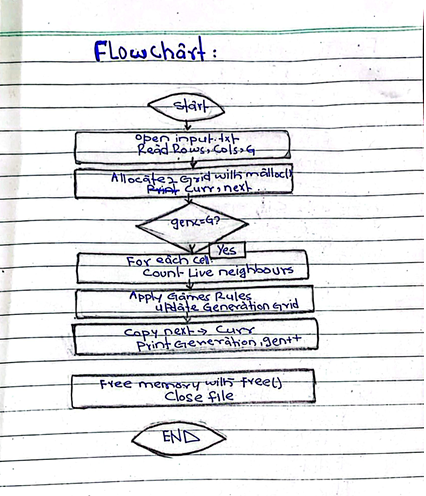
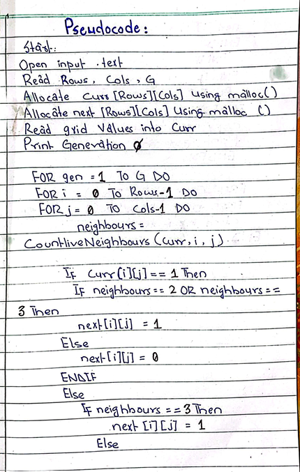
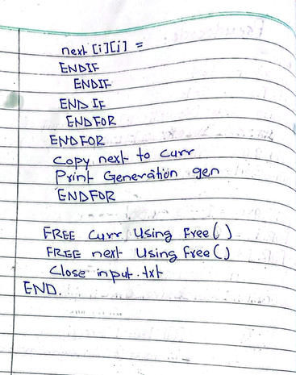
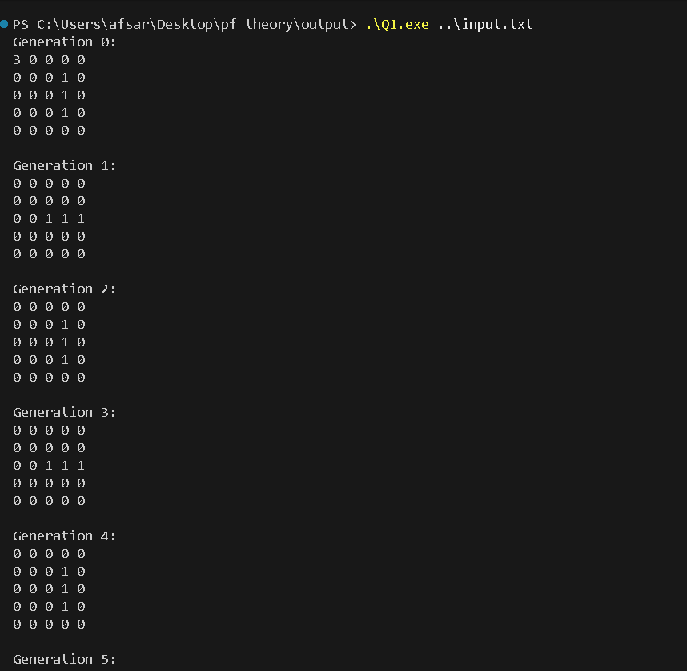
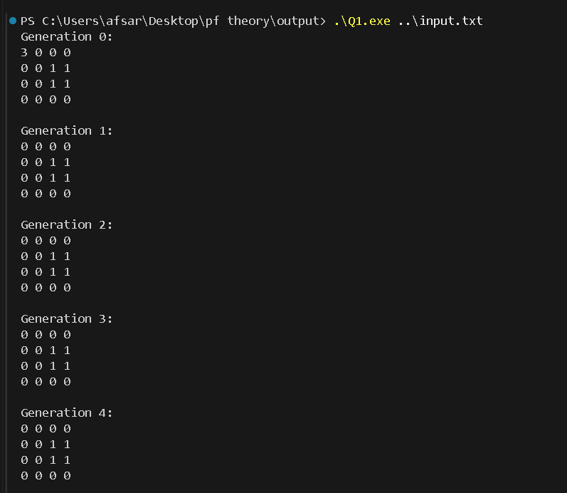

# Question 1 -Mini report

## Overview
This program reads data from `Input.txt`, processes it, and prints the result.

## Flowchart

## Pseudo-code

## code
Q1.c
## How to Run
gcc Q1.c -o Q1.exe -lm
./Q1.exe Input.txt
## Output

## Learning
I learned file handling and how to process data using loops.
