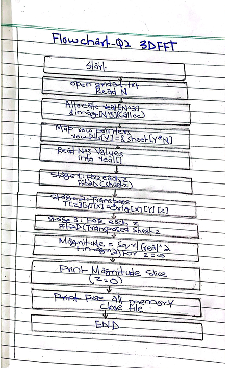
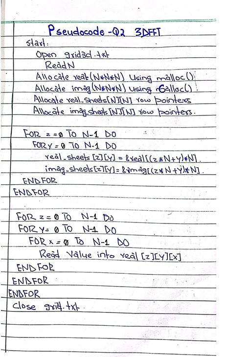
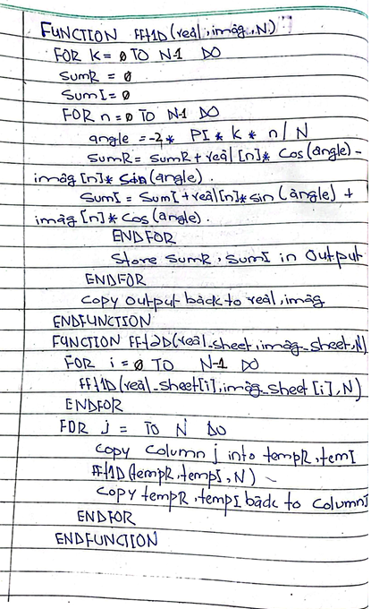
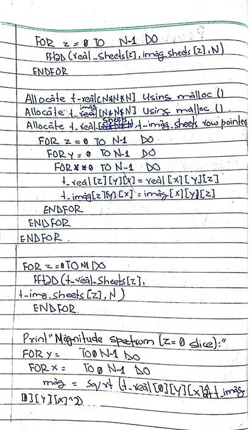
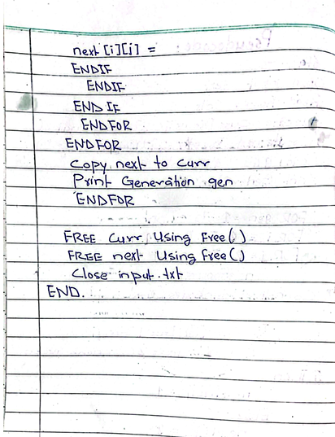
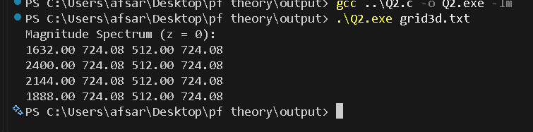
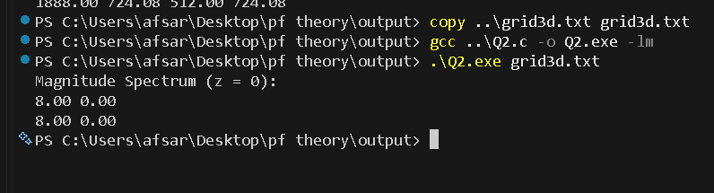

# Question 2 - Mini Report

## 1. Overview
This program applies a 2D Fast Fourier Transform (FFT) on every 2D slice of a 3D grid.

The input file `grid3d.txt` contains:
- First value: `N` (size of the grid)
- Next `N x N x N` values: grid data

For each `z-slice`, the program applies 1D FFT on all rows, then on all columns, and finally prints the Magnitude Spectrum.

## 2. Brainstorming / Flowchart
I first made a hand-drawn flowchart to plan the logic.

## 3. Pseudo-code (Handwritten)
I converted the flowchart into pseudo-code.

## - Output 1
Input: `N = 4`, values `0 to 63`

## - Output 2
Input: `N = 2`, all values `1`

## 7. What I Learned
I learned how 2D FFT works using two 1D FFT passes, how to handle 3D data from a file, and how to calculate magnitude from complex numbers.
