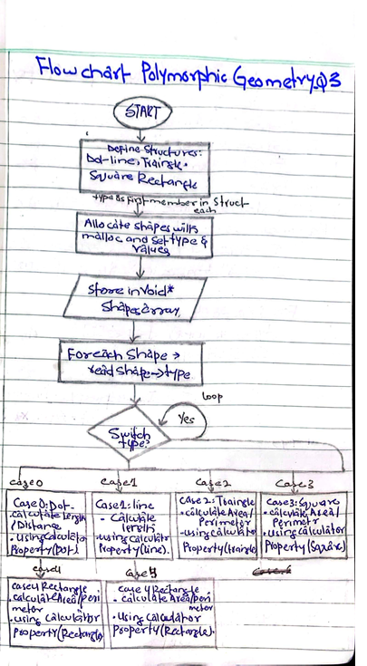
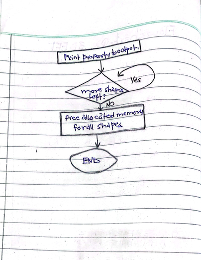
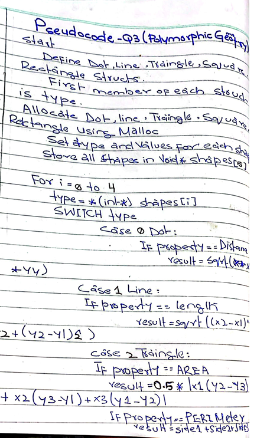
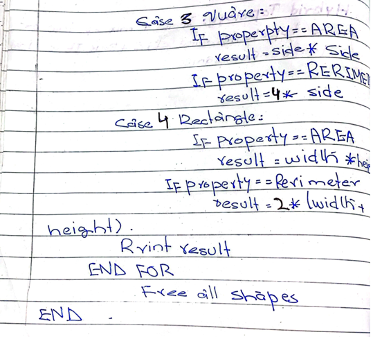
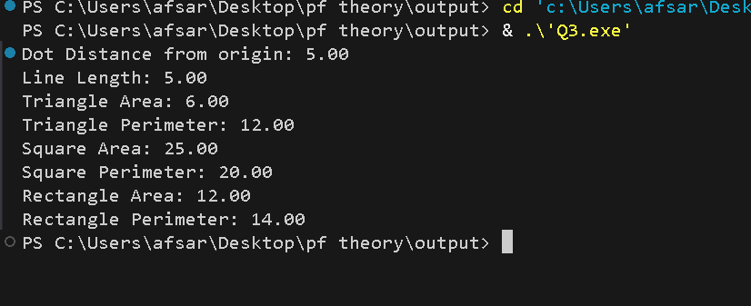
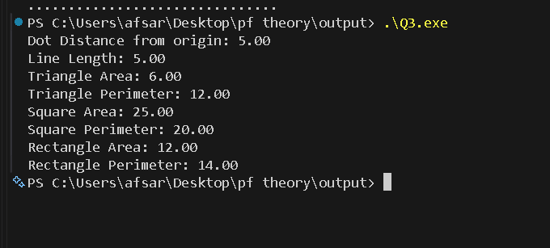

# Question 3 - Polymorphic Geometry Engine using void* and Structs | Mini Report

##  Overview
This program simulates Object-Oriented Polymorphism in C using Structs, Type Tagging, and `void*` Generic Pointers.

All shapes share a common first member `int type`, which acts as a type tag:
- `Dot` - type 0
- `Line` - type 1
- `Triangle` - type 2
- `Square` - type 3
- `Rectangle` - type 4

A single generic function `calculateProperty(void *shapePtr, int propertyType)` handles all shapes polymorphically by reading `*(int*)shapePtr` and using a `switch-case`.

##  Brainstorming / Flowchart

## Pseudo-code (Handwritten)

##  Code File
Q3.c

## Output 1

## Output 2

## what I learned
I learned how `void*` works, how type tagging simulates polymorphism, how `switch-case` can dispatch functions, and how to use dynamic memory allocation with structs.
