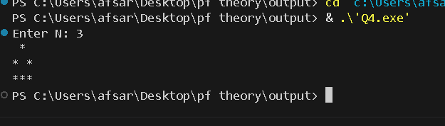
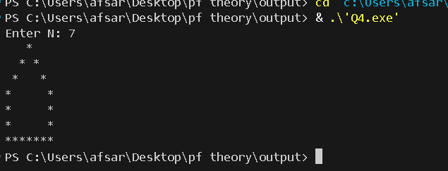

# Question 4 - Pattern Printing | Pentagon Pattern | Mini Report

##  Overview
This program prints a Pentagon Pattern made of `*` for odd values of `N`.

The pattern is hollow from inside, only the border is printed with `*`. The size of the pentagon increases with `N`.
## Code 
Q4.c
## Output - N = 3

## Output - N = 7

## 6. What I Learned
I learned how to use nested loops for pattern printing, how to calculate left and right positions of `*` using rows and columns, and how to handle user input for dynamic pattern size.
