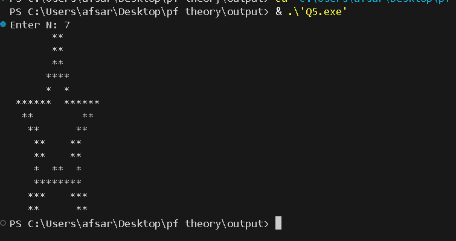
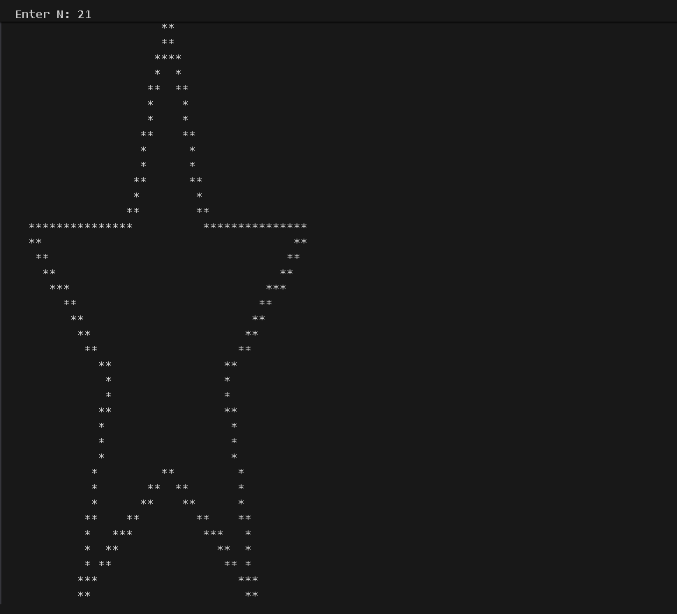

# Question 5 - Pattern Printing | Star Pattern | Mini Report

## Overview
This program prints a Star Pattern (5-pointed Star) made of `*` for odd values of `N`.

The pattern is hollow from inside, only the border is printed with `*`. The size of the star increases with `N`.

##  Code File
Q5.c
## Output - N = 7

## Output - N = 21

## 6. What I Learned
I learned how to use 2D canvas for pattern printing, how to calculate star points using `cos` and `sin`, how to draw lines between points, and how to handle user input for dynamic pattern size.
