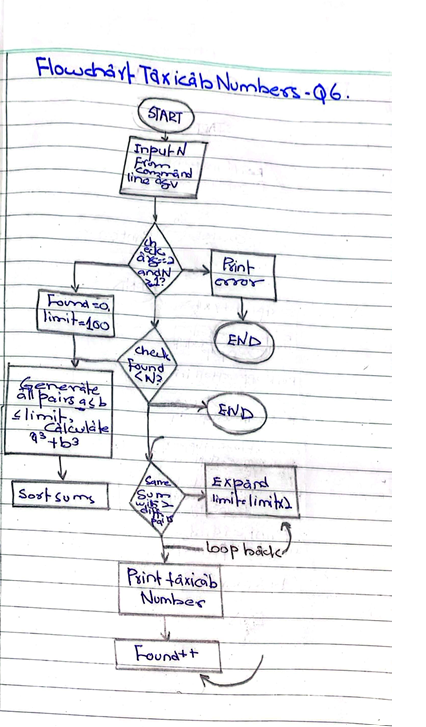
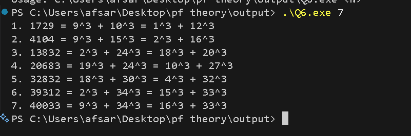
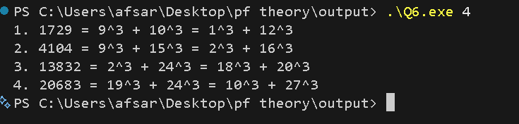

# Question 6 - First N Ramanujan-Hardy Taxicab Numbers
### Overview
A Taxicab Number `Ta(2)` is a positive integer that can be expressed as sum of two positive cubes in at least two distinct ways
## code file
Q6.c
## flowchart / brainstroming

## Pseudocode
(Q6pseudocode1.png)
(Q6pseudocode2.png)
 ## flowchart

## output

