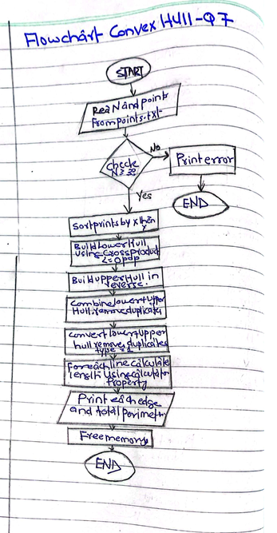
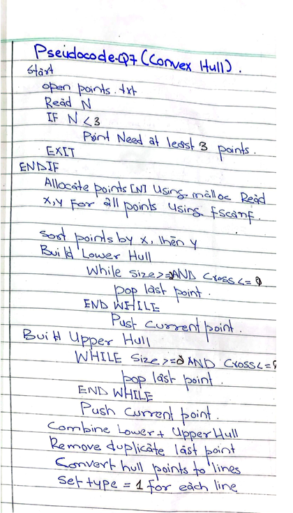
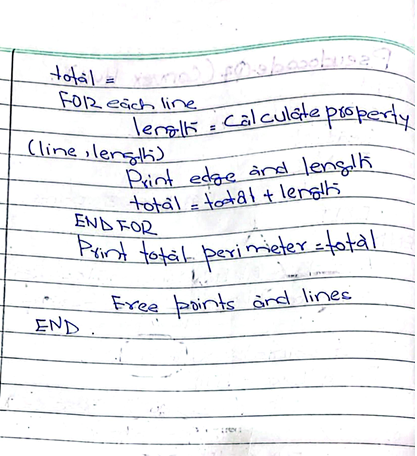
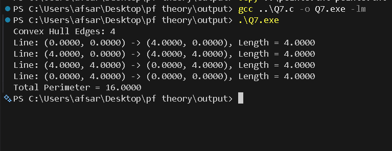
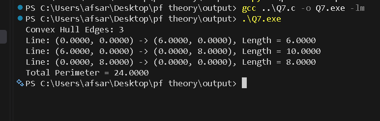

# Question 7 -Geometric Convex Hull Engine
### Overview
The Convex Hull is the smallest convex polygon that encloses a given set of 2D points. It can be visualized as stretching a rubber band around pegs on a board.
## Input File - `points.txt`
This file contains the input points for the Convex Hull Engine.
## code file
Q7.c
## flowchart / brainstroming

## Pseudocode

## output

